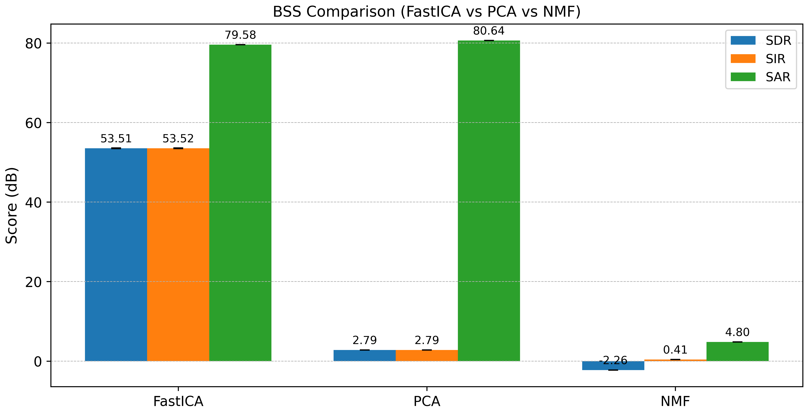

# FastICA audio source separation · Reproducible research repository

[](https://doi.org/10.1002/eng2.70575)
[](https://doi.org/10.1002/eng2.70575)
[](LICENSE)
[](requirements.txt)

**Three-source blind audio separation using FastICA, compared with PCA and mono-STFT NMF.** This repository provides the research notebook reconstructed from the original locally executed Jupyter HTML, with portability safeguards, three input profiles, reproducibility instructions and a no-human-speech demo.

**Code author and maintainer:** **Md. Razu Ahmed** · [ORCID: 0009-0001-8646-1881](https://orcid.org/0009-0001-8646-1881) · **Email:** [razuahmed038@gmail.com](mailto:razuahmed038@gmail.com) · [Portfolio](https://beingrazuahmed.github.io/projects.html#fastica-audio-project) · [GitHub](https://github.com/beingrazuahmed).

**Peer-reviewed article:** Ahmed, M. R., Mauya, J., Reza, M. S., & Amin, R. (2026). Sophisticated Audio Source Separation: A Statistical Exploration of Clarity and Precision With FastICA. *Engineering Reports, 8*(1), e70575. **DOI:** [10.1002/eng2.70575](https://doi.org/10.1002/eng2.70575).

> **Data/privacy:** The original participant recordings are not publicly available owing to ethical and privacy restrictions. They, their mixtures and their separated speech must **not** be uploaded to this repository. This project contains no participant audio or embedded playback results. Only generated, non-human synthetic demo files may be created locally (and are ignored by Git). See [DATA_AVAILABILITY.md](DATA_AVAILABILITY.md).

## What this project does

1. Load **three distinct local reference recordings** (mono or stereo; WAV/MP3 and other FFmpeg-supported formats). Decode, resample to **48 kHz**, downmix to mono, silence-trim, RMS-normalize and crop to a common duration.
2. Create a controlled **3×3 linear instantaneous mixture** with a fixed random seed. This is not source extraction from an unknown single-channel recording; the original clean tracks provide the reference for evaluation.
3. Estimate sources with **FastICA**; compare against multichannel **PCA** and a mono-STFT **NMF** baseline.
4. Align separated tracks with references using `mir_eval.separation.bss_eval_sources`, calculate **SDR, SIR and SAR**, aggregate mean ± SD across runs, and produce CSV and comparison-chart outputs.
5. Optionally hear the originals, a mixture preview and aligned separated tracks **locally**. Playback is enabled; do not save notebook outputs with private audio before pushing to GitHub.

**Important:** The three-source design and the reference-based evaluation require three **distinct** input tracks. New recordings will run through the same pipeline, but performance metrics may differ substantially. No guarantee of successful separation for noisy, reverberant, correlated or short recordings. The original study intentionally tested a controlled mixture, not general real-world acoustic scenes.

## Quick start (no private recordings needed)

Install **Python 3.12** and [FFmpeg](https://ffmpeg.org/) (for MP3/other encoded files), then from the repository directory:

```bash
python -m venv .venv
# Windows PowerShell: .venv\Scripts\Activate.ps1
# macOS/Linux: source .venv/bin/activate
python -m pip install -r requirements.txt
python scripts/generate_demo_audio.py
```

Choose **one** execution mode before starting Jupyter:

| Mode | What to do | Audio | Typical purpose |
| --- | --- | --- | --- |
| **Synthetic demo** | Set `FASTICA_PROFILE=demo` and `FASTICA_RUNS=1`; run the notebook | Generated mathematical signals; no voices | Trial without restricted data |
| **Custom recordings** | Set `FASTICA_PROFILE=custom`; place `source_1.wav`, `source_2.wav`, `source_3.wav` in private `Raw Data/`, or change names in the configuration cell | Your own properly licensed/consented tracks | Reuse with different audio |
| **Original experiment** | Leave default `FASTICA_PROFILE=original`; supply the three authorized MP3s listed in the notebook | Restricted PUST recordings; not distributed | Reproduce the exact paper's experimental conditions |

### Profile configuration

On **Windows PowerShell**, for a quick generated demo:

```powershell
$env:FASTICA_PROFILE="demo"
$env:FASTICA_RUNS="1"
python -m jupyter lab
```

On **macOS/Linux**:

```bash
FASTICA_PROFILE=demo FASTICA_RUNS=1 python -m jupyter lab
```

Open [`notebooks/FastICA_Audio_Source_Separation.ipynb`](notebooks/FastICA_Audio_Source_Separation.ipynb) and select **Run All Cells**. For custom recordings, use `FASTICA_PROFILE=custom` and optionally `FASTICA_PRIVATE_AUDIO_DIR` for a folder elsewhere on your local computer. Edit `CUSTOM_AUDIO_FILENAMES` if you have different file names or provide absolute paths via `FASTICA_AUDIO_FILES` separated by your OS's path separator (`;` on Windows, `:` on macOS/Linux). No Kaggle dataset, online connection or cloud account is required to run your files locally. See [REPRODUCIBILITY.md](REPRODUCIBILITY.md) for detailed controls and troubleshooting.

**Audio permissions:** Use only recordings you own or are authorized to process and share. For copyrighted or personally identifying speech, honor consent and institutional requirements. The demo generator is the simplest permission-free starting point.

## Study results (as published, not recomputed in this release)

| Method | SDR (dB) | SIR (dB) | SAR (dB) |
| --- | ---: | ---: | ---: |
| **FastICA** | **53.51 ± 0.07** | **53.52 ± 0.07** | **79.58 ± 0.00** |
| PCA | 2.79 ± 0.00 | 2.79 ± 0.00 | 80.64 ± 0.00 |
| NMF (mono-STFT baseline) | −2.26 ± 0.00 | 0.41 ± 0.00 | 4.80 ± 0.00 |

These results were obtained for the published **three original recordings**, fixed mixing design and **10 runs**, with BSS Eval alignment. They **must not be presented as results for custom or synthetic signals**. New audio, preprocessing, package versions, or algorithm settings may change the scores. The code and demo have been checked, but full ten-run original-paper numerical verification remains pending.

## Research figures

The author supplied all nine TIFF masters, and each has been converted into a browser-compatible PNG while preserving the original scientific graphics.

**Figure 9 — FastICA, PCA and NMF performance (uploaded)**



**Figures 1–8 — converted, pending binary upload:** The original workflow, paired waveform/spectrogram comparisons for the three recording variants, and mixed-audio visualization are prepared for the repository's `figures/` folder. Their filenames and original captions are documented in the [figure inventory](figures/README.md) and [manifest](figures/figure_manifest.csv). Once committed, the full nine-figure set can be incorporated into the [portfolio showcase](https://beingrazuahmed.github.io/projects.html#fastica-audio-project).

For local figure importing, see `python scripts/import_figures.py --help` (Pillow is an optional dependency). The official [publisher article/DOI](https://doi.org/10.1002/eng2.70575) remains the source for the full paper; no duplicate publisher PDF is included.

## Repository structure

```text
.
├── figures/                       # figure guide + manifest, Figure 9; Figures 1–8 pending
├── notebooks/FastICA_Audio_Source_Separation.ipynb
├── scripts/
│   ├── generate_demo_audio.py     # produces three synthetic, non-speech WAVs locally
│   ├── import_figures.py          # optional TIFF ZIP → browser-friendly PNG converter
│   └── check_public_release.py    # checks for risky files / notebook outputs
├── tests/test_repository.py       # built-in unittest checks
├── .github/workflows/quality.yml  # GitHub Actions structural/privacy checks
├── README.md                      # this guide
├── REPRODUCIBILITY.md             # original, custom and synthetic run modes
├── DATA_AVAILABILITY.md           # participant privacy & authorized data access
├── METHODS_AND_LIMITATIONS.md     # scientific assumptions and results scope
├── CITATION.cff                   # GitHub citation integration
├── CITATION.bib                   # BibTeX for the article and software
├── AUTHORS.md                     # code, paper authorship, acknowledgments
├── VALIDATION_REPORT.md           # tested capabilities and remaining limits
├── CHANGELOG.md                   # changes since HTML export
├── CONTRIBUTING.md               # code contribution and privacy policy
├── CODE_OF_CONDUCT.md
├── SECURITY.md
├── LICENSE                       # MIT for repository code, not the private audio
├── requirements.txt
├── .python-version
└── .gitignore
```

`demo_audio/`, `Raw Data/`, `outputs_bss/`, encoded audio, generated results, saved notebook outputs and local caches are **excluded** from the public release. FFmpeg may create local `*.canonicalized.wav` files next to custom MP3s; these remain private.

## Citation, permissions and credit

If you use this **research method**, please cite the peer-reviewed paper. If you use or adapt the **code**, also cite this repository (GitHub's **Cite this repository** uses [`CITATION.cff`](CITATION.cff)). Example BibTeX is in [`CITATION.bib`](CITATION.bib). The MIT license permits code reuse, modification and redistribution **subject to preserving its notice and license**; it does **not** license the separate research article, participant recordings, data or third-party dependencies. See [`LICENSE`](LICENSE) and [`AUTHORS.md`](AUTHORS.md).

**Permission requests for the restricted participant audio:** Refer to the published paper's Data Availability Statement and contact its corresponding author. Sending an email does not guarantee access, and access is subject to applicable consent, ethics and institutional approvals. **Code questions and collaboration:** [razuahmed038@gmail.com](mailto:razuahmed038@gmail.com).

## Transparency and reproducibility status

- Original code was authored and executed in a desktop Jupyter environment and recovered from the supplied HTML export.
- This public version preserves the scientific separation and evaluation algorithms, with documented portability, missing-file, input-validation and privacy-output guards.
- Both demo and custom-audio workflows passed complete **one-run end-to-end tests**, including algorithm evaluation and CSV/PNG generation; see [`VALIDATION_REPORT.md`](VALIDATION_REPORT.md). The original **full 10-run published numerical evaluation has not been independently rerun**.
- `mir_eval` 0.8.2's BSS Eval implementation is deprecated; the original method is deliberately retained here to avoid silently changing metric definitions.
- `requirements.txt` pins the versions known from the study where available; it is **not a fully frozen cross-platform environment lockfile**.

*This research code is provided as-is, without any warranty of fitness for a particular audio separation task.*